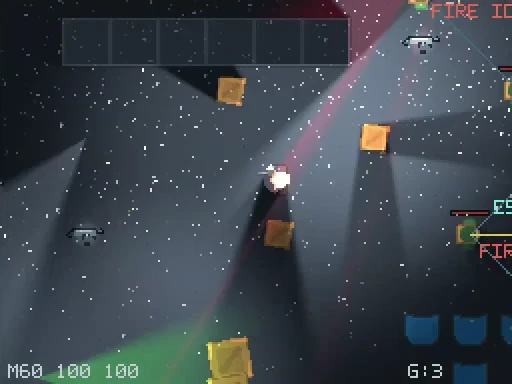

# 👋 Hi, I'm Dmytro Stramousov

---

## 📈 GitHub activity

<!-- Total Commits: includes commits from previous years, as counted by the widget. -->

<!-- Contributions include activity beyond commits. The chart shows public contribution activity. -->

---

## About me

Software and Performance Test Engineer with 20+ years of experience in software development, UNIX environments, distributed systems and performance engineering.

I like building software that interacts with real things.

- ⚡ Performance, load, smoke and regression testing
- 🔎 Bottleneck analysis and system diagnostics
- 🐧 Linux / UNIX as the primary engineering environment
- 🧪 Backend and frontend test automation
- 🐍 Python tooling and automation
- 🐳 Dockerized test and development environments
- 🔧 Hardware, serial interfaces and embedded experiments
- 🎮 Game engines, graphics and procedural systems
- 🕹 Retro computers, emulation and old hardware
- 🧠 Experiments are more interesting than buzzwords

> Build it. Measure it. Break it. Understand it. Improve it.

## 🎮 MODE256 256*192 = 49 152 пикселя ностальгии.

Когда-то демосцена ZX Spectrum поразила меня магией на 3,5 МГц, и 48 килобайтами памяти и палитрой, которая напоминала бред шизофреника. 
Из ограничения сделали искусство из которого появились Дмитрии Гуртяк и иже с ними, а из каждого такта - восхтщение неофита , т.е. меня.
С тех пор прошло сорок лет: памяти теперь достаточно даже программам, которым "**достаточно 640Кб**". Но захотелось проверить, **что будет, если вернуть экрану честные 256×192 пикселя, а вычисления доверить современному CPU**. 
Так появился то чем я занимаюсь вечерами - Mode256,  2D/2.5D движок, в котором можно увидеть, или не увидеть то что когда то волновало.

### Что  работает

- **🎨 Программный рендеринг.** Собственный CPU-рендерер, RGBA, прозрачность, слои, буфер глубины и целочисленное масштабирование без "Игорьтонет". В кадре ровно **49 152 пикселя**.
- **🌲 Игровые миры и растительность.** Большие карты, камера, тайлы, сооружения и более **1300 растений** в лесной сцене. Контент собирается в **Tiled**, затем проходит собственный компилятор.
- **💡 Свет и тени.** Цветные источники, прожекторы, высота света, затухание, затенение поверхностей, силуэтные тени и геометрия сооружений.
- **🌧️ Погода и частицы.** Дождь, снег, ветер, порывы, турбулентность, искры, дым и фонтаны частиц. Осадки взаимодействуют с поверхностями и глубиной сцены.
- **🔥 Огонь.** Анимированные костры, искры и мерцающий тёплый свет.
- **📦 Физика и разрушения.** **Box2D**: столкновения, масса, инерция, вращение и толкание предметов. Ящики накапливают повреждения и распадаются на физические обломки.
- **🔫 Оружие и эффекты.** Пистолет и автоматическое оружие, отдача, разброс, перезарядка, трассеры, вспышки, рикошеты, дым и следы попаданий. Выстрелы на мгновение освещают сцену.
- **🤖 AI противников.** Охрана, патрулирование, поле зрения, проверка прямой видимости, память о последнем контакте, поиск точки наблюдения и обход препятствий.
- **🎮 Управление и камера.** Клавиатура, мышь, геймпад, физическое движение персонажа, плавное слежение камеры и навигационная инфраструктура.
- **🎵 Звук старой школы.** **PT3, TurboSound, AYFX** — музыка и эффекты с узнаваемым характером AY.
- **🔧 Инструменты и оптимизация.** **F12 Developer Inspector**, профилирование, настройка эффектов, пространственные индексы, отсечение невидимых объектов и кеширование.

**Технологии:** C++ · SDL3 · Box2D · Tiled · Python · CMake · Linux.

**Mode256 пока не готовая игра**, а развивающийся движок и лаборатория. Классическая демосцена доказывала, что невозможное можно показать.

*Когда-то 48 килобайт хватало для чуда. Теперь у нас гигабайты — и всё те же 256×192 пикселя, которые напоминают с чего это начиналось.*

---

  

---

## 🛠 Tech & tools

### Performance & testing

  
  
  
  
  

  
  
  
  
  
  

### Development

  
  
  
  
  
  

### Backend, infrastructure & data

  
  
  
  
  
  

### Everyday tools

  
  
  

<b>Legacy stack & older systems</b>

 

`PHP` · `Perl` · `MySQL` · `Oracle` · `Informix` · `XML` · `AJAX` · `jQuery` · `Shell scripting`

---

## 🎓 Early certifications

> Brainbench certifications from the early 2000s

   
   
   

- **Linux Programming (General)** — Brainbench, 2000
- **Perl Programmer** — Brainbench, 2001
- **C Programmer** — Brainbench, 2001
